# DevoJK
DevoJK is a Jedi Knight: Jedi Academy multiplayer client by **Devoted**. It's built on [JKSunny's EternalJK](https://github.com/JKSunny/EternalJK) with the Vulkan PBR renderer, which itself builds on [EternalJK](https://github.com/eternalcodes/EternalJK), [jaPRO](https://github.com/videoP/jaPRO) and [OpenJK](https://github.com/JACoders/OpenJK).

Its heart is **DevoGI**, a new ray-traced lighting system that relights every map in the game. We had two goals: **performance and realism**, both at once.

> **Status:** first beta. Things may still change; feedback is very welcome under [issues](https://github.com/Dadunito/DevoJK/issues).

## Gallery
Ffa3, both performance modes in a visual comparison. **Low spec** GI is fully baked, and heavily optimized for lower spec machines, **high spec** adds the live sun and dynamic lighting with real-time shadows, prebaked Global Illumination style.

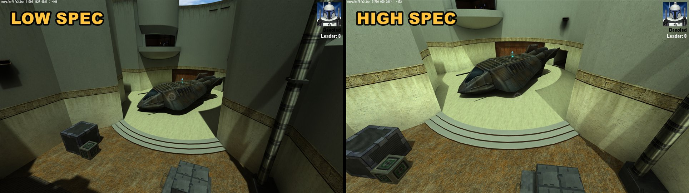
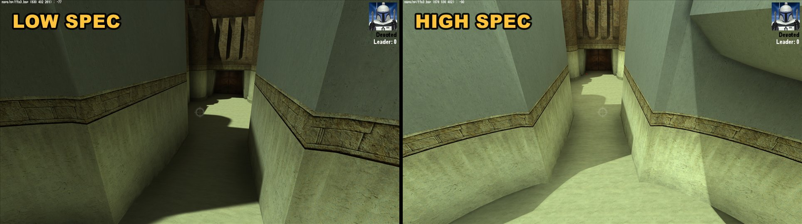
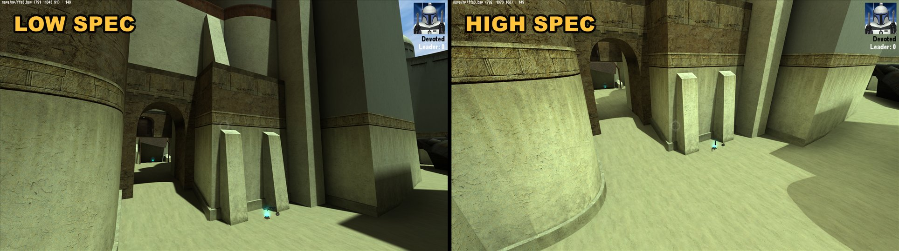
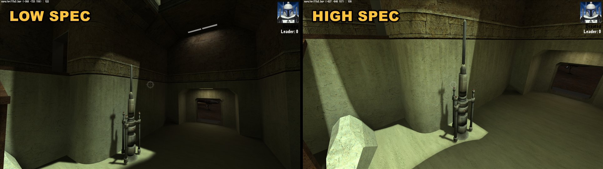
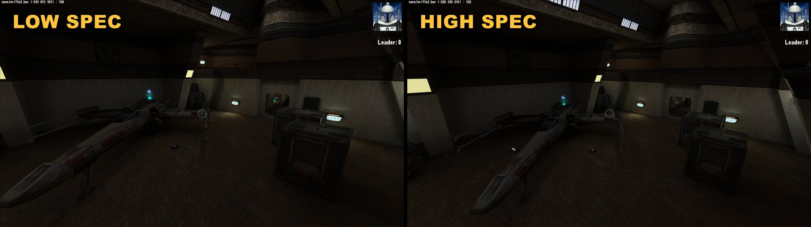
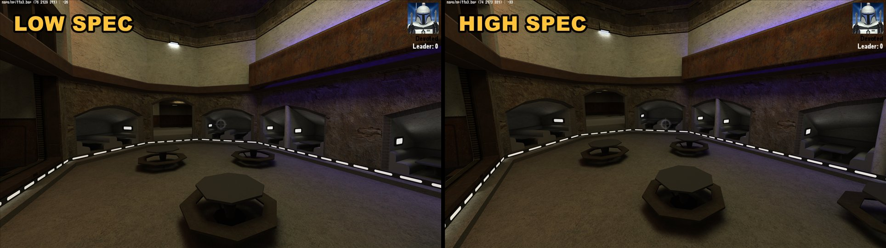
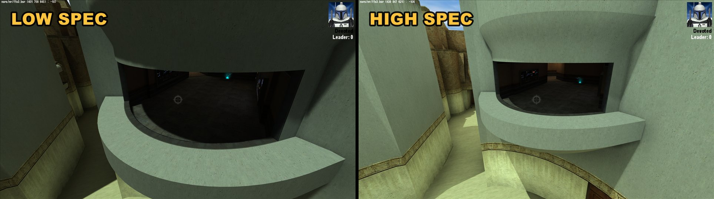
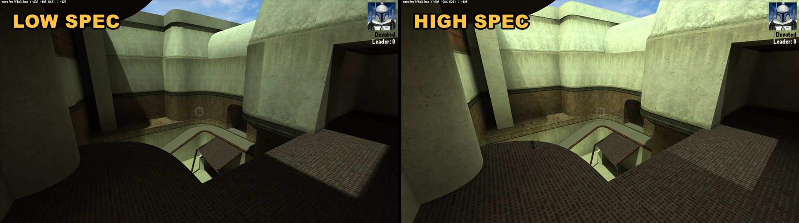

### Live shadows up close
| | |
|---|---|
| 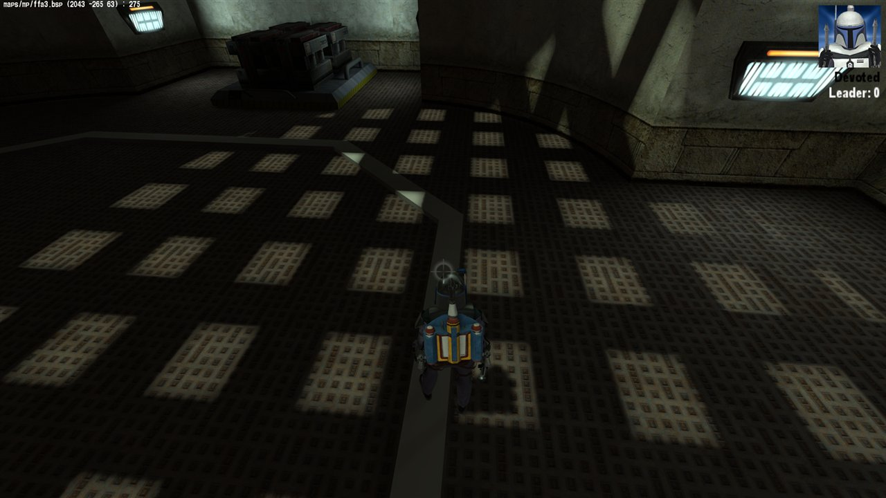 | 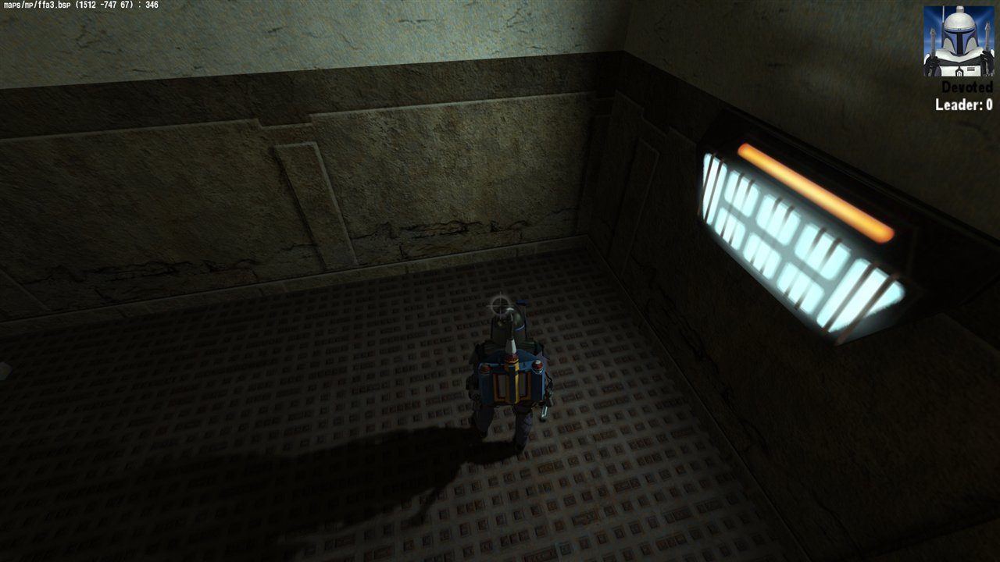 |
| Complex shadows fall smoothly across the character | Lights near you cast the shadows of everything that moves |
| 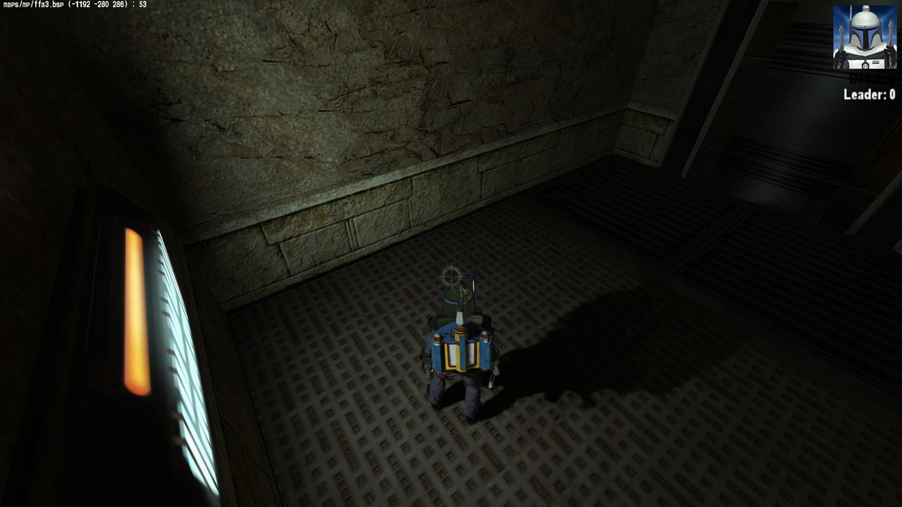 | 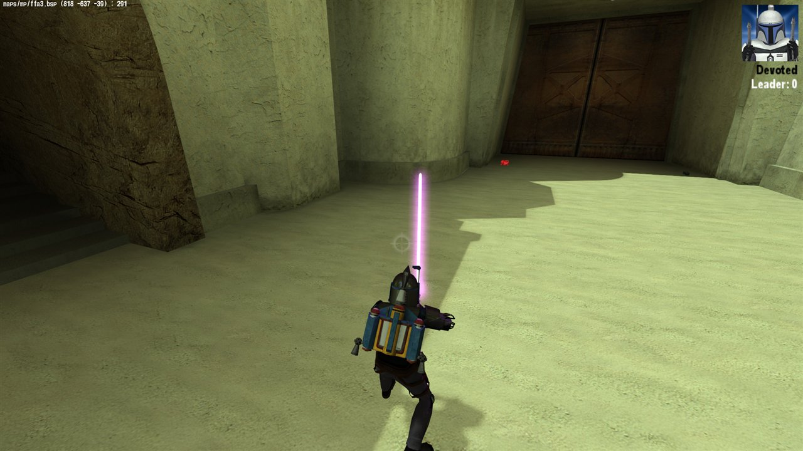 |
| Every nearby light source, not just the sun | Smooth, even shadows, whatever hangs above |

## Features
* **Fully baked global illumination for every PC.** Low spec mode bakes everything: bounced light, soft shadows, darker corners, colour carried from wall to wall. In game it costs nothing more than the original lighting. Baking a map takes a while the first time, about 5 to 8 minutes for a map like ffa3 and longer for big indoor maps. Sorry about that! We're working on making it much faster. Once a map is baked, it's baked for good, and the wait is worth it.
* **High spec mode: baked and live, in levels of detail.** The sun is drawn live with real-time shadows. Light sources switch smoothly with distance: far away they're baked, in view they shine live over their baked shadows, and right next to you they cast real-time shadows of players, weapons and anything else that moves. The handover is designed to be invisible to the naked eye, while the expensive work only happens where you can see it.
* **The original lighting is never touched.** DevoGI swaps out a map's whole lighting without destroying anything: the classic lightmaps stay in the map as they were. To go back, just turn DevoGI off.
* **Drag-and-drop realism.** The ray tracer reads a map's lights however the mapper made them: light entities, shaders with surface lights, glowing textures, the sun and the sky. Nobody has to change their workflow, so every standard map is relit automatically, and that is the part we're proudest of.
* **Precompile Shaders.** A little tool in the game folder that bakes the lighting for as many maps as you like, outside the game. Let it run while you use your PC for something else, or while you build your own maps.
* **Full integration into Q3Map2.** [DevoQ3Map2](https://github.com/Dadunito/DevoQ3Map2) has the same baker built in: `mapcompiler -devogi`. Mappers can ship the baked lighting inside their pk3, and players get it with no wait. Mappers are very welcome!
* **SFX sabers, fixed and back.** The SFX saber system is reintegrated and fixed: the trail only shows while swinging, it has a length setting, black blades keep their colour, and the menus preview the SFX blade too.
* **DevoJK settings menu.** Setup → DevoJK, with a Vulkan page and a DevoGI page. The main switch is **Performance mode**: Low spec or High spec.

Everything about the settings, baking and recommended values is in the **[manual](MANUAL.md)**.

## Credits
DevoJK only exists thanks to the people who brought Vulkan and incredible graphics to Jedi Knight, and everyone who kept the game alive before them. Thank you to:
* **[JKSunny](https://github.com/JKSunny)**, for the Vulkan renderer, PBR and many graphics improvements in EternalJK. DevoJK is built directly on this work.
* **[ec-](https://github.com/ec-) and the [Quake3e](https://github.com/ec-/Quake3e) contributors**, whose Vulkan renderer the EternalJK one is based on, along with [kennyalive's Quake-III-Arena-Kenny-Edition](https://github.com/kennyalive/Quake-III-Arena-Kenny-Edition) and [suijingfeng's vkQuake3](https://github.com/suijingfeng/vkQuake3), which started it.
* **[eternal](https://github.com/eternalcodes)**, for creating and maintaining EternalJK, and **[bucky](https://github.com/Bucky21659)** for contributing to it.
* **[loda](https://github.com/videoP)**, for jaPRO and the client-side features EternalJK is built around.
* **The [OpenJK](https://github.com/JACoders/OpenJK) team** (JACoders), including ensiform, Razish, xycaleth, eezstreet, mrwonko and many more, for years of engine fixes and improvements.
* **redsaurus and [JKEnhanced](https://github.com/JKEnhanced/OpenJK)**, for SFX sabers.
* **The [q3map2](https://github.com/isRyven/map-compiler) authors**, id Software, ydnar, the NetRadiant team, Aciz and ryven, whose compiler DevoQ3Map2 builds on.
* **Raven Software and Activision**, for making Jedi Academy and releasing its source code.

## For players
1. Download the latest release, or build DevoJK yourself (see below).
2. Copy the files into your Jedi Academy `GameData` folder. For Steam, that's `<Steam Folder>/steamapps/common/Jedi Academy/GameData/`.
3. Run `eternaljk.x86_64.exe`. The Vulkan renderer is selected with `cl_renderer rd-vulkan`.
4. Go to Setup → DevoJK and pick your **Performance mode**. The [manual](MANUAL.md) explains the rest.

## For developers
### Building
DevoJK uses CMake. On Windows with Visual Studio:
```
cmake -S . -B build -A x64
cmake --build build --config Release
cmake --install build --config Release --prefix <install folder>
```
The install folder gets the client, both renderers (`rd-vulkan` and `rd-eternaljk`) and the `EternalJK` folder with the game modules and assets. The Precompile tool and `mapcompiler.exe` come from [DevoQ3Map2](https://github.com/Dadunito/DevoQ3Map2).

### Where things are
* `codemp/rd-vulkan/devogi_core.cpp`: the baker. It's shared word for word with DevoQ3Map2, so the game and the compiler always bake the same lighting.
* `codemp/rd-vulkan/tr_devogi.cpp`: how the renderer uses the bake: loading, live lights, sun and light-source shadows.
* `codemp/rd-vulkan/vk_devo_shadow.cpp`: the shadow map image.
* `tools/devojk_menu.py`: generates the DevoJK menu from two simple tables.

### Contributing
Bug reports, suggestions and pull requests are welcome under [issues](https://github.com/Dadunito/DevoJK/issues).

Fixes that also apply upstream are worth sending to [JKSunny/EternalJK](https://github.com/JKSunny/EternalJK) as well.

### Vulkan support
From the EternalJK README by JKSunny: Vulkan support was first started by porting [Quake-III-Arena-Kenny-Edition](https://github.com/kennyalive/Quake-III-Arena-Kenny-Edition), then took its file structure from [vkQuake3](https://github.com/suijingfeng/vkQuake3/tree/master/code), and is now based on [Quake3e](https://github.com/ec-/Quake3e), which is actively maintained and has many additions. A list of those additions is [here](https://github.com/ec-/Quake3e#user-content-vulkan-renderer).

## License
[](LICENSE.txt)

DevoJK, like OpenJK, is licensed under GPLv2 as free software. You are free to use, modify and redistribute it following the terms in [LICENSE.txt](LICENSE.txt). See [rv-readme.txt](rv-readme.txt) for Raven's original source release notes.

## Author
* **Devoted**
